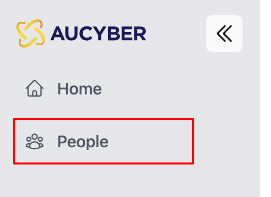
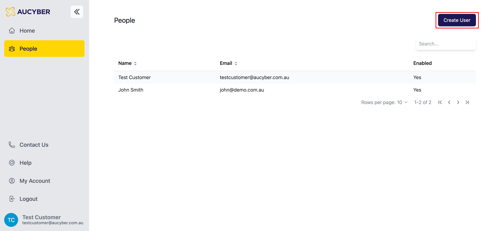
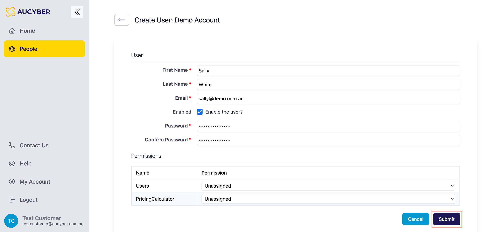
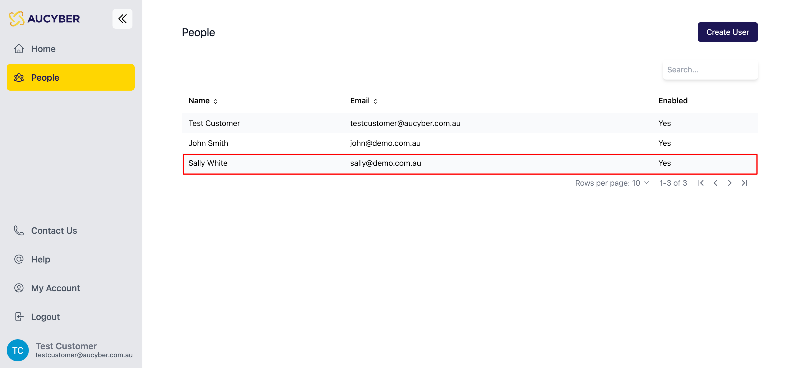
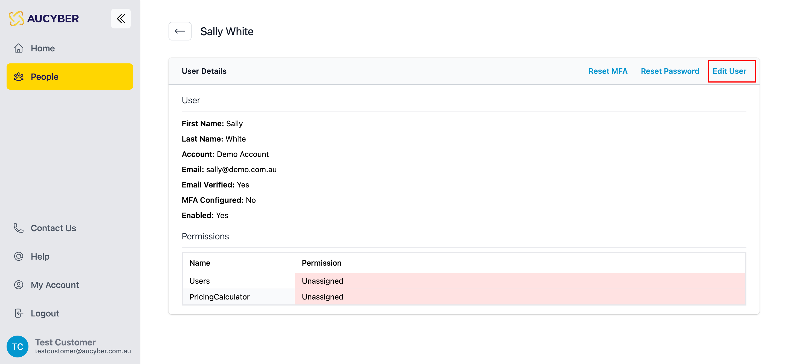
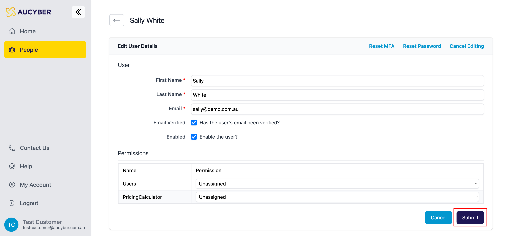
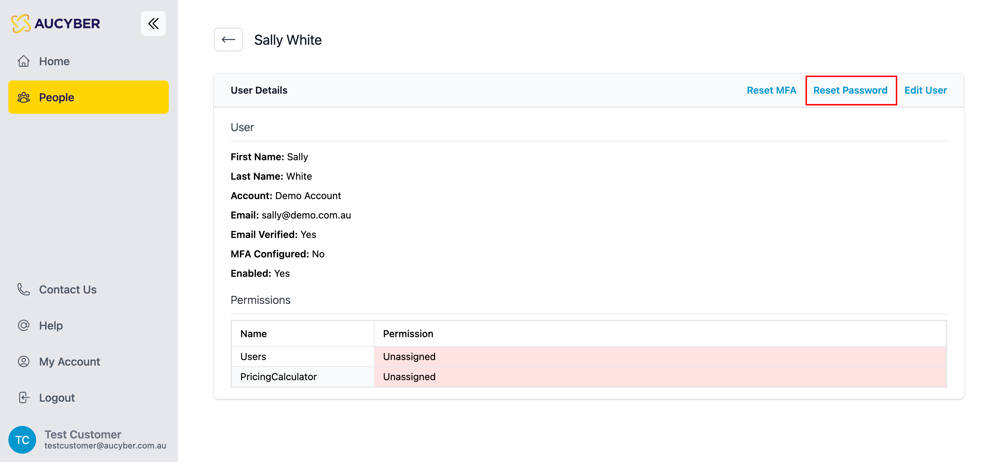
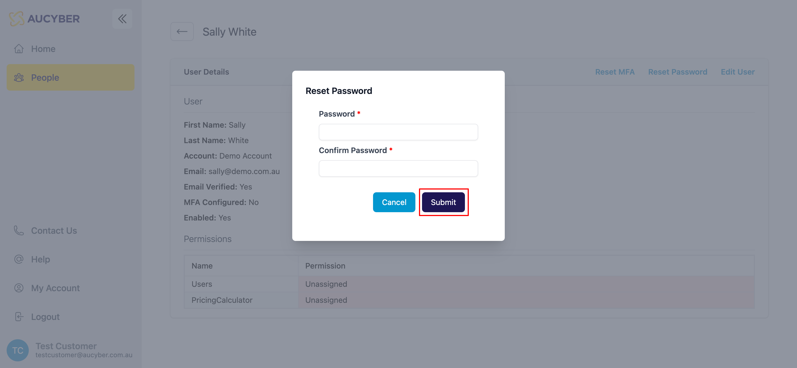
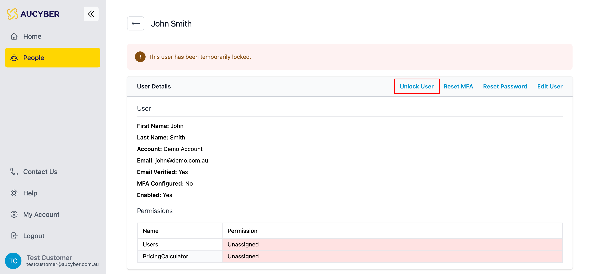
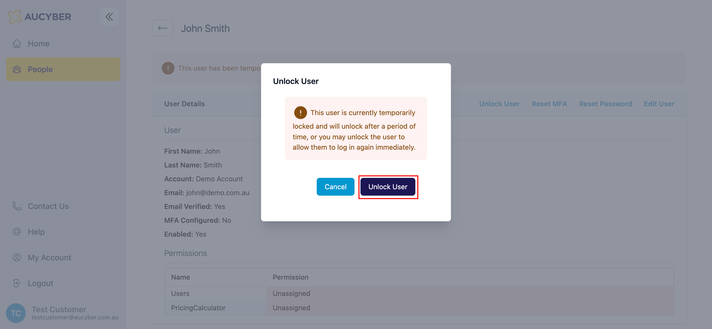

!!! info "Effective from the Portal release"
    This page describes the AUCyber Portal at [portal.aucyber.com.au](https://portal.aucyber.com.au), scheduled for release in Q4 2026. These instructions take effect once the Portal is released. Until then, continue to use the [legacy Portal](../portal/index.md) at portal.australiacloud.com.au and its documentation.

## Overview
This guide is for customers who have an [administrator role](#granting-portal-administration-privileges). These customers are able to manage users in their organisation, including creating new users and modifying existing users' accesses.

### Getting into the administration console
1. [Log in](./portal-login.md) to the Portal with your account that has Portal user management privileges at https://portal.aucyber.com.au.
   
1. On the left sidebar, click the **People** tab.
   
    {: style="width:300px;border:1px solid black;"}

1. The browser will navigate you to the user management page.

### Adding A New User
1. Click the **Create User** button.

    {: style="border:1px solid black;"}

1. The create user dialog will open. Enter the user's name, email and password, tick the **Enabled** checkbox so that the user is able to log in, and set any required permissions using the dropdowns before clicking submit to create the user.

    !!! note "A user that is not enabled cannot log in"
        If you do not tick the **Enabled** checkbox, the user is created but cannot log in until an administrator edits the user and enables them.

    {: style="border:1px solid black;"}

1. The browser will navigate back to the list of people after successfully creating the user. The user will be required to set up an MFA token and reset their password on their first login.

### Editing a User's Details

#### Getting to the User Details page

1. Click the username of the user you wish to edit. You can also use the search bar to search for the user if required.

    {: style="border:1px solid black;"}

1. The website will navigate to that user's details page.

#### Change personal details and permissions
1. Once on the [user's details page](#getting-to-the-user-details-page), you can click the **Edit User** button to update that user's details.

    {: style="border:1px solid black;"}

1. Update any required details and permissions and click submit.

    {: style="border:1px solid black;"}

#### Change password
1. Once on the [user's details page](#getting-to-the-user-details-page), to change a user's **password**, click the **Reset Password** button.

    {: style="border:1px solid black;"}

1. Type the user's new password in the **Password** and **Confirm Password** input fields and click **Submit**.

    {: style="border:1px solid black;"}

1. The users password has now been changed. This is a temporary password, and the user will be prompted to change it on their next login.

#### Resetting a user's MFA

If a user has lost access to their authenticator app, for example after changing phones, an administrator can remove the user's existing MFA credentials so that they can set up MFA again.

1. Navigate to the [user's details page](#getting-to-the-user-details-page).

1. Click the **Reset MFA** button.

1. A confirmation dialog will appear warning that the action cannot be reversed. Click the **Delete MFA Credentials** button to confirm.

1. On their next login, the user will be prompted to set up new MFA credentials. The setup steps are the same as [steps 8 to 10 of the initial account setup](./portal-account-setup.md#initial-setup).

#### Unlocking an account

Sometimes, a user may be locked due to multiple failed attempts to log in. To unlock it as a user administrator:

1. Navigate to the [user's details page](#getting-to-the-user-details-page).

1. On a disabled user, there will be a warning message stating that the user is temporarily locked. To unlock them, click the **Unlock User** button.
    {: style="border:1px solid black;"}

1. A window will pop up asking you to confirm the action. Click the **Unlock User** button to confirm.
    {: style="border:1px solid black;"}

1. The user is now unlocked and can attempt to log in once more.

#### Granting Portal administration privileges

To assign roles granting a user admin permissions in the portal, simply update that users permissions on the edit user screen (see [Change personal details and permissions](#change-personal-details-and-permissions)).

#### Revoking Portal administration privileges

To unassign roles granting a user admin permissions in the portal, simply update that user's relevant permission to be 'Unassigned' on the edit user screen (see [Change personal details and permissions](#change-personal-details-and-permissions)).