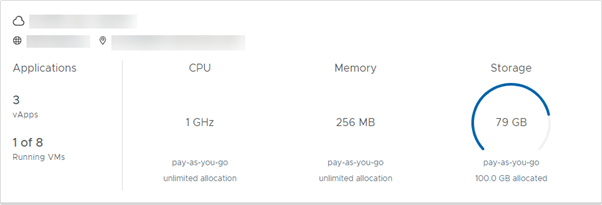

### Overview

Before allocating more disk space in your AUCyber for VMware account, it is useful to check how much of your allocated space has been used.  

### Viewing your storage usage (VMware Cloud Director)

1. In the VMware Cloud Director _Virtual Datacenters_ dashboard, go to the card for your data centre.

2. The _Storage_ section shows how much storage you're currently using as well as the amount of allocated storage.

    

### Viewing your storage usage (VMware Cloud Director API)

To check your storage profile usage programmatically, you need to call the appropriate VMware Cloud Director REST API endpoint.

The example assumes that you have [created a VCD API token](../using-the-api-new/create_vcd_api_token.md) and set up the following three environment variables:

- `VCD_API_URL`: the API server URL for your tenancy from [the list of AUCyber VMware Cloud Director API Endpoints](../../reference_urls.md#vmware-cloud-director-api-endpoints), without the `https://` prefix
- `VCD_ORG`: the [unique name of your VCD tenancy](../using-the-api-new/retrieve_tenancy_name.md)
- `VCD_API_TOKEN`: your VCD API token

The example makes two calls to the API. The first call exchanges the API token for an access token, as described in [Authenticating into VMware Cloud Director](../using-the-api-new/authentication_methods.md):

`curl -X POST "https://$VCD_API_URL/oauth/tenant/$VCD_ORG/token" -H "Content-Type: application/x-www-form-urlencoded" --data-urlencode "grant_type=refresh_token" --data-urlencode "refresh_token=$VCD_API_TOKEN"`

Having received an `access_token` in the response body, the second call passes it as a Bearer token in the `Authorization` header:

`curl -H "Authorization: Bearer <access_token>" -H "Accept: application/*+xml;version=37.2" -i "https://$VCD_API_URL/api/query?type=orgVdcStorageProfile"`

This call returns an XML structure, in which you can see an `OrgVdcStorageProfileRecord` element containing the following properties:

`storageLimitMB="512000" storageUsedMB="65536"`
