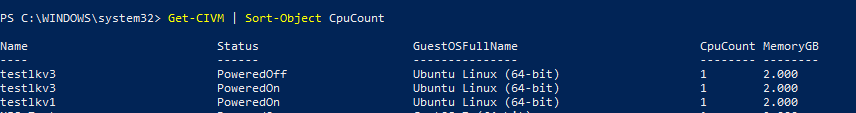

## Overview

VMware PowerCLI is a Microsoft PowerShell based command line interface tool which was developed by VMware to manage and automate tasks on various VMware platforms such as vSphere, VMware Cloud Director, Horizon, etc.

The latest version of PowerCLI is available from the [VMware website.](https://developer.vmware.com/powercli)

If your system has connection to the internet, you can perform the following to install the PowerCLI module:

``` > Install-Module VMware.PowerCLI -Scope CurrentUser ```

To establish a connection to the AUCyber platform using PowerCLI you will need a VCD API token, the unique name of your VCD tenancy and the API server URL of the VMware Cloud Director instance that you want to connect to. Username and password authentication is not available for AUCyber Portal accounts.

!!! note

    PowerCLI 13.1 or later is required. Earlier versions do not accept a bearer token as the session ID.

### Connect to AUCyber using a VCD API token

1. Create a VCD API token by following [this guide](./create_vcd_api_token.md) if you do not already have one
1. [Retrieve the unique name of your VCD tenancy](./retrieve_tenancy_name.md)
1. Retrieve the API server URL for your VCD tenancy from [the list of AUCyber VMware Cloud Director API Endpoints](../../reference_urls.md#vmware-cloud-director-api-endpoints)
1. Exchange your API token for an access token by running the following in a PowerShell window:

    ``` powershell
    $ApiUrl   = "<API-Url>"
    $Org      = "<Org-Id>"
    $ApiToken = "<API-Token>"

    $Response = Invoke-RestMethod -Method Post `
        -Uri "https://$ApiUrl/oauth/tenant/$Org/token" `
        -ContentType "application/x-www-form-urlencoded" `
        -Body @{ grant_type = "refresh_token"; refresh_token = $ApiToken }

    $AccessToken = $Response.access_token
    ```

    !!! note

        **API-Url** :  API URL you just retrieved, without the `https://` prefix

        **Org-Id** : unique name of your VCD tenancy

        **API-Token** : the VCD API token you created

    The access token expires after a period of time. When it expires, run the above again to obtain a new one.

1. Using this access token you can establish a connection to the AUCyber platform by performing the following command:

    ```
    > Connect-CIServer -Server $ApiUrl -SessionId $AccessToken
    ```

1. Once connected, you can start using PowerCLI commands to retrieve information/manage the ecosystem within your vDC Organisation. To verify that you have logged in to the environment successfully, you can perform a simple command line to retrieve all VMs in your tenancy by running the command below :

    ```
    > Get-CIVM
    ```

    Example of the output:

    
